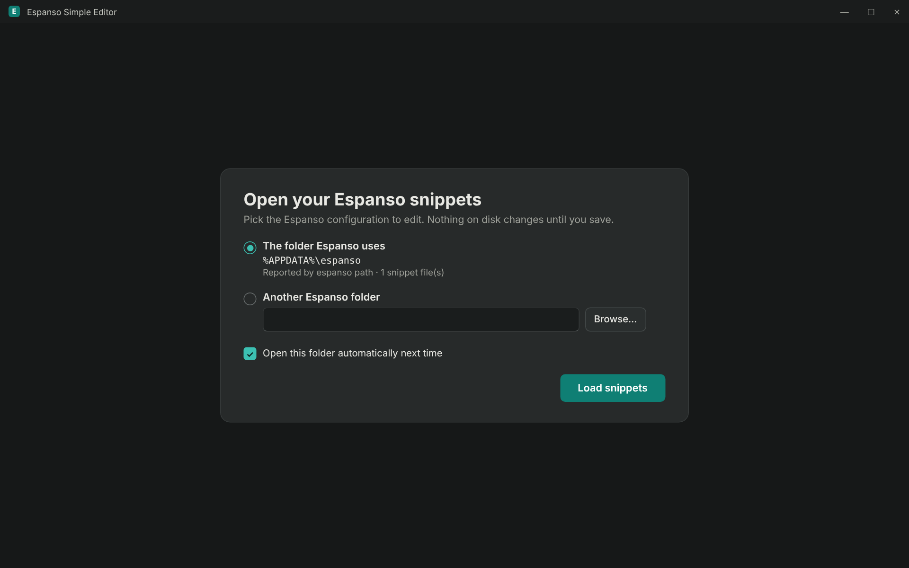
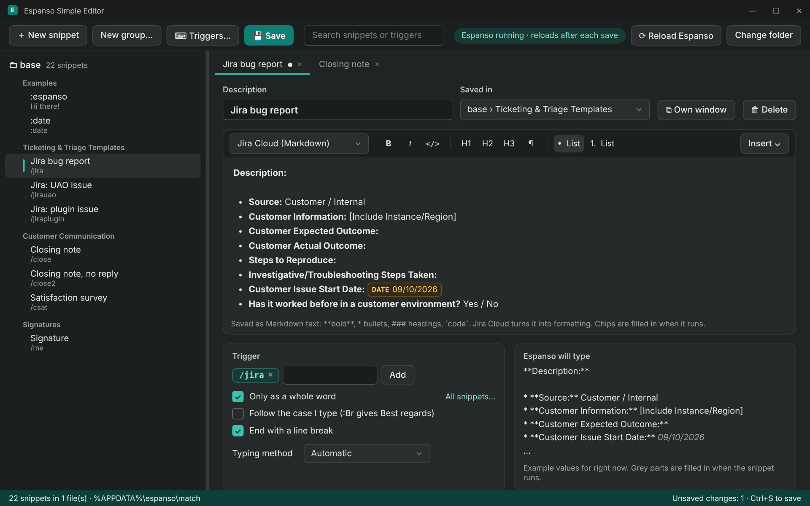
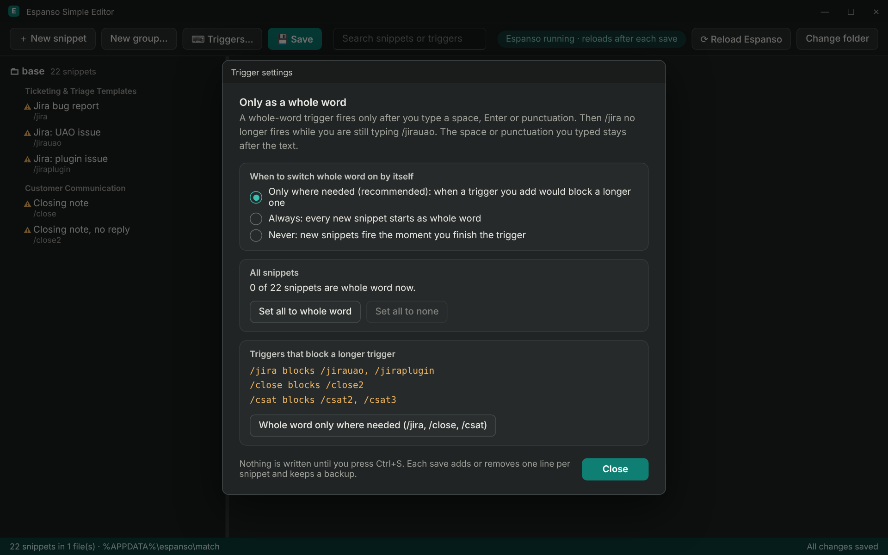
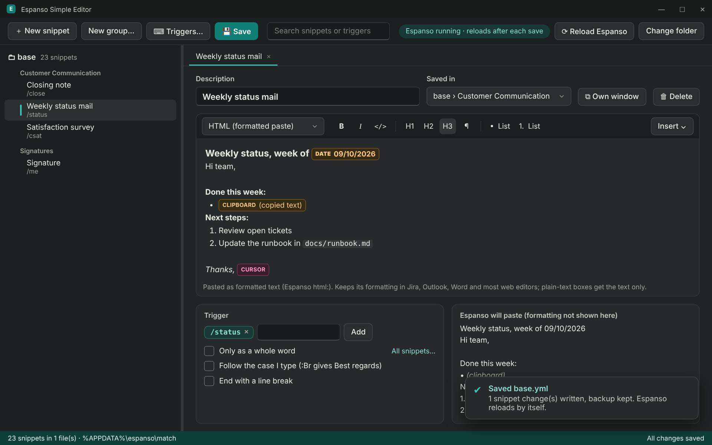

# Espanso and Espanso Simple Editor

> **In short**
> **Espanso** is a free, open source text expander: type a short trigger such as `/jira` and it is replaced with a full template.
> **Espanso Simple Editor** is a small Windows app to manage your Espanso snippets in a PhraseExpress-style window, without editing YAML files.
> Owner: Csaba Kovacs. Status: early version, feedback welcome.

---

## Why Espanso instead of PhraseExpress

* **Free for work use:** open source (GPL-3.0), no licence needed. PhraseExpress is only free for personal use.
* **Lightweight:** runs quietly in the background.
* **Plain text files:** snippets live in `.yml` files, so they are easy to back up, share and keep in version control.
* **Built-in features:** dates, clipboard, PowerShell output, "fill in the blanks" forms, and a search bar (`Alt+Space`) to find any snippet.
* **Cross-platform:** the same snippets work on Windows, macOS and Linux.

---

## Espanso basics

### Install

1. Download Espanso for Windows from `https://espanso.org/install/` and run the installer.
2. Espanso starts in the system tray.
3. Type `:espanso` in any text box. If it turns into `Hi there!`, it works.

### Where snippets live

* Config folder: `%APPDATA%\espanso` (run `espanso path` to see yours).
* Snippets: `match\base.yml`, plus any other `.yml` file in the `match` folder.
* Behaviour settings: `config\default.yml`.
* Espanso reloads by itself after a snippet file is saved.

### Useful commands

* `espanso status`: is it running?
* `espanso restart`: reload everything.
* `espanso path`: show the config folder.
* `espanso install <package>`: add a package from the Espanso Hub.

### Tips

* **Triggers that start with another trigger:** Espanso expands as soon as a trigger is typed, so `/jira` fires before you can finish `/jirauao`. Fix: tick **Only as a whole word** (`word: true`) on the short one, or rename it.
* **Whole word** triggers fire only after a space, Enter or punctuation, and that character stays after the text.
* **Jira Cloud:** write templates in Markdown (`**bold**`, `* ` bullets, `### ` headings). Jira Cloud turns them into formatting.

---

## Espanso Simple Editor

### What it does

_Mockup: pick the Espanso folder once; it opens by itself next time._

* Opens your Espanso folder and lists every snippet: files as folders, comment lines like `# --- Tickets ---` as groups.
* One snippet per tab, or in its own window. **You never see YAML.**
* Writes valid Espanso YAML on save, and Espanso picks it up by itself.

### Getting it

* Ask Csaba for the latest zip. Run `dist\small\EspansoSimpleEditor.exe`, which needs the **.NET 10 Desktop Runtime**.
* Or build it from source with `BUILD.bat`, which needs the **.NET 10 SDK**.

### Editing a snippet

_Mockup: library on the left, a Jira Cloud snippet on the right, with trigger options and a preview._

* **Description:** shown in Espanso's search bar.
* **Saved in:** which file and group it belongs to.
* **Format:**
  * **Plain text:** typed as it is.
  * **Jira Cloud (Markdown):** bold, italic, code, headings and lists; saved as Markdown that Jira turns into formatting.
  * **HTML (formatted paste):** pasted as rich text, good for Outlook and Word.
* **Insert:** date, time, clipboard, cursor position, "ask when typing" fields, PowerShell output, random choice. These appear as coloured chips; double-click one to change it.
* **Trigger:** add or remove triggers, **Only as a whole word**, **Follow the case I type**, and the typing method.
* **Preview:** shows what Espanso will type, with example values.

### Trigger box (`Triggers…` button)

_Mockup: the trigger box, with triggers that block longer ones and a one-click fix._

* **Only where needed (default):** whole word is switched on automatically when a new trigger would block a longer one.
* **Set all to whole word** or **Set all to none**, with Undo.
* Lists every trigger that blocks a longer one, with a one-click fix.

_Mockup: an HTML snippet with date, clipboard and cursor chips, just after saving._

### Saving and safety

* `Ctrl+S` saves. Only the snippets you changed are rewritten; comments and everything else stay exactly as they were.
* Every save is checked by reading the file back. If anything would come out differently, nothing is saved.
* A backup is made before each save in `%LOCALAPPDATA%\EspansoSimpleEditor\backups` (last 30 kept).
* If a file changed on disk since you opened it, the app asks before overwriting.
* Snippets using features the editor does not cover (images, regex triggers, scripts and similar) open read-only and are left untouched.

### Shortcuts

* `Ctrl+S` save
* `Ctrl+N` new snippet
* `Ctrl+F` search
* `Ctrl+W` close tab
* `Ctrl+B` / `Ctrl+I` bold and italic in Jira Cloud and HTML snippets

---

## Troubleshooting

* **Snippet doesn't expand:** check the status pill in the editor, or run `espanso status`. Use **Reload Espanso** if needed.
* **Wrong snippet fires:** look for the warning sign next to it in the library; one trigger probably blocks another.
* **Status looks wrong:** details are in `%LOCALAPPDATA%\EspansoSimpleEditor\espanso-cli.log`.
* **Undo a bad save:** copy the file back from the latest backup folder.

---

## Known limits

* Links and tables in formatted snippets are not supported yet.
* Editing app-specific profiles (`config` folder) is not supported yet.
* Windows only.
